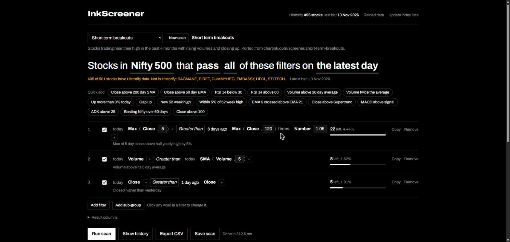
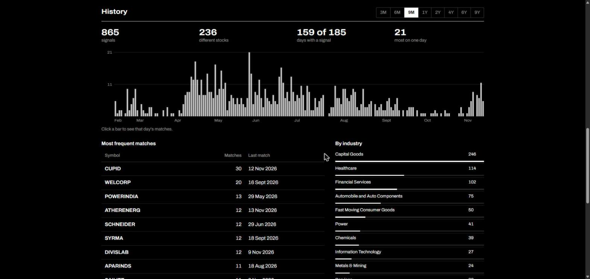

# InkScreener

A point-and-click stock screener for Indian equities that runs on your own machine, on daily
candles stored by [OpenAlgo](https://github.com/marketcalls/openalgo) Historify.

Build scans the way you would on Chartink: pick a universe (Nifty 50, 100, 200 or 500), add
filters, and click any word in a filter to change it. InkScreener shows the matching stocks,
how many stocks each filter leaves, and a history of when the scan fired.





## Features

- **Click-to-build filters.** Every part of a filter is clickable: the day ("today", "6 days ago"),
  the measure (Close, SMA, RSI, Max, Supertrend, Nifty 50 Close, a number), its settings
  (periods, multipliers), the operator (Greater than, Crossed above) and math (plus, minus,
  times, divided by).
- **Quick add** for common filters such as "Close above 200 day SMA", "RSI 14 below 30",
  "New 52 week high" and "EMA 9 crossed above EMA 21".
- **Logic like Chartink.** Stocks that *pass* or *fail* *all* or *any N* of the filters, plus
  nested sub-groups for combinations such as (A and B) or (C and D).
- **Universes.** Nifty 50, Nifty 100, Nifty 200, Nifty 500 or every stock in Historify.
  Constituent lists are downloaded from NSE.
- **Filter funnel.** After a run, each filter shows how many stocks are still in the running.
- **Results table** with company and industry, sortable columns, search, CSV export and your own
  columns (any measure, number format, green or red by sign).
- **History.** Matches per day for the last 3 months to 9 years. Click a bar to see that day's stocks.
- **Scan files.** Scans are saved as readable YAML in `scans/`, so they can be shared and versioned.
- **Fast.** A full Nifty 500 scan over 10 years of daily data takes about 0.3 seconds.

## Requirements

- Python 3.11 or newer
- [OpenAlgo](https://github.com/marketcalls/openalgo) with **Historify** daily data (see below)
- Internet access on first start, to download the Nifty index lists from NSE

## Prepare data in OpenAlgo Historify

InkScreener only reads data. It never writes to the Historify database.

1. Run OpenAlgo and open **Historify**.
2. Add the stocks you want to screen (for example the Nifty 500 list, exchange `NSE`) to the
   Historify watchlist.
3. Add the **NIFTY** index (exchange `NSE_INDEX`). InkScreener uses it as the trading calendar and
   for relative strength filters such as "Beating Nifty over 60 days".
4. Download **daily (D)** candles. A few years of history is enough for most scans; long
   lookbacks (200 day averages, 52 week highs, multi-year history) need more.

The database is usually at `openalgo/db/historify.duckdb`.

## Installation

```bash
git clone https://github.com/marketcalls/inkscreener.git
cd inkscreener
```

Create a virtual environment and install the dependencies. With [uv](https://docs.astral.sh/uv/):

```bash
uv venv
uv pip install -r requirements.txt
```

Or with plain pip:

```bash
python -m venv .venv
# Windows
.venv\Scripts\activate
# macOS / Linux
source .venv/bin/activate
pip install -r requirements.txt
```

## Configuration

Copy `.env.example` to `.env` and set the path to your Historify database:

```ini
HISTORIFY_DB_PATH=C:\path\to\openalgo\db\historify.duckdb
```

If `HISTORIFY_DB_PATH` is not set, InkScreener looks for `../openalgo/db/historify.duckdb`, which
works when this repository is cloned next to your OpenAlgo folder.

| Variable | Default | Purpose |
|----------|---------|---------|
| `HISTORIFY_DB_PATH` | `../openalgo/db/historify.duckdb` | Historify DuckDB file, opened read-only |
| `INKSCREENER_SCANS_DIR` | `scans` | Folder for saved scans |
| `INKSCREENER_INDICES_DIR` | `data/indices` | Folder for the NSE index lists |
| `INKSCREENER_BENCHMARK` | `NIFTY` | Benchmark index symbol in Historify |
| `INKSCREENER_AUTO_DOWNLOAD` | `1` | Set to `0` to skip downloading index lists on first start |

## Run

From the repository folder, with the virtual environment active:

```bash
python -m uvicorn app.main:app --port 8000
```

Open http://127.0.0.1:8000.

On first start the app downloads the Nifty 50, 100, 200 and 500 lists from NSE into
`data/indices/`. Use **Update index lists** in the header to refresh them after an index
rebalance. Use **Reload data** after downloading new candles in Historify.

## Using the screener

1. **Pick a saved scan** from the menu, or press **New scan**.
2. **Set the sentence** at the top: *Stocks in* [universe] *that* [pass or fail] [all, any one,
   any 2, ...] *of these filters on* [the latest day or a date you pick].
3. **Add filters** with **Quick add**, or **Add filter** to choose a measure from the menu.
4. **Click any word in a filter to change it.**
   - *today* or *6 days ago*: which day to look at.
   - Bold words such as **Close** or **SMA**: the measure. The menu is searchable.
   - Boxed numbers: periods and values.
   - *Greater than*, *Crossed above*: the comparison.
   - The dashed **+**: add math, for example "times 1.05". Click the math word to change or remove it.
5. **Add sub-group** for mixed logic. Each sub-group has its own pass or fail and all or any N.
6. **Run scan** (filters also re-run automatically as you change them). Each filter shows how many
   stocks are left after it.
7. **Result columns** lets you add, rename, format and color columns.
8. **Show history** charts matches per day. Click a bar to load that day's matches.
9. **Save scan** writes `scans/<scan_name>.yaml`. **Export CSV** downloads the current table.

### How the logic works

| You want | Set |
|----------|-----|
| A and B and C | pass **all** |
| A or B or C | pass **any one** |
| At least 2 of A, B, C | pass **any 2** |
| Not (A and B) | **fail all** |
| None of A, B, C | **fail any one** |
| (A and B) or (C and D) | pass **any one**, with two sub-groups set to pass **all** |

A stock without enough history for a filter (for example a 200 day average on a recent listing)
never matches, not even under *fail*. Such stocks are counted as "skipped for short history".

## Scan files

Scans are YAML files in `scans/`. The builder writes them for you, but they are easy to read and
edit by hand:

```yaml
name: Short term breakouts
description: Stocks near their 4 month high with rising volume, closing up.
universe: nifty500            # nifty50 | nifty100 | nifty200 | nifty500 | historify
group:
  match: all                  # all | any 1 | any 2 | ...
  negate: false               # true means "fail"
  filters:
  - expr: max(close, 5) > max(close, 120)[6] * 1.05
    note: Max of 5 day close above the 120 day high by 5%
  - expr: volume > sma(volume, 5)
  - expr: close > close[1]
  - group:                    # a nested sub-group
      match: any 1
      filters:
      - expr: rsi(close, 14) > 60
      - expr: adx(14) > 25
columns:
- expr: close
  as: Close
  format: number              # number | percent | integer
  decimals: 2
- expr: pct_change
  as: '% Chg'
  format: percent
  color: true                 # green when positive, red when negative
sort:
  by: '% Chg'
  desc: true
```

### Expression reference

`x[n]` means *x as of n trading days ago*: `close[1]` is yesterday's close and
`max(close, 120)[6]` is the 120 day high as it stood 6 days ago.

**Fields:** `open`, `high`, `low`, `close`, `volume`, `pct_change`, `change`, `hl2`, `hlc3`, `ohlc4`.
Prefix with `nifty.` for the Nifty 50 index, for example `nifty.close`.

**Operators:** `+ - * /`, `> >= < <= == !=`, `and`, `or`, `not`, and chained comparisons such as
`100 < close < 2000`.

| Function | Meaning |
|----------|---------|
| `sma(x, n)`, `ema(x, n)`, `wma(x, n)`, `rma(x, n)` | Moving averages (simple, exponential, weighted, Wilder) |
| `max(x, n)`, `min(x, n)`, `sum(x, n)`, `std(x, n)` | Highest, lowest, total and standard deviation over n days |
| `rsi(x, n=14)` | Relative Strength Index |
| `macd_line(x, 12, 26)`, `macd_signal(x, 12, 26, 9)`, `macd_hist(x, 12, 26, 9)` | MACD |
| `stoch_k(n=14)`, `stoch_d(n=14, d=3)` | Stochastic oscillator |
| `atr(n=14)`, `adx(n=14)`, `plus_di(n=14)`, `minus_di(n=14)` | Volatility and trend strength |
| `supertrend(n=10, mult=3)` | Supertrend line |
| `bb_upper(x, n=20, k=2)`, `bb_lower(x, n=20, k=2)` | Bollinger bands |
| `crossed_above(a, b)`, `crossed_below(a, b)` | a crossed b today |
| `count(condition, n)` | Days in the last n on which the condition was true |
| `abs(x)`, `round(x, d)`, `greatest(a, b, ...)`, `least(a, b, ...)` | Math helpers |

Expressions are parsed against an allow-list of fields, functions and operators, so a scan file
can never run arbitrary Python. Filters that the click builder cannot show (for example
`a and b` inside one filter, or `count(...)`) still run, and appear in the app as read-only
filters.

## API

The interface is a single page on top of a small JSON API.

| Method | Path | Purpose |
|--------|------|---------|
| GET | `/api/status` | Data source, symbols, date range |
| POST | `/api/reload` | Reload data from Historify |
| GET | `/api/universes` | Universes and how many symbols have data |
| POST | `/api/universes/refresh` | Download the index lists from NSE again |
| GET | `/api/builder` | Measures, operators and quick filters for the builder |
| GET | `/api/scans` | Saved scans |
| GET / PUT | `/api/scans/{id}` | Read or save a scan |
| POST | `/api/run` | Run a scan: `{"scan_id": "...", "as_of": "2026-11-13", "universe": "nifty50"}` or an inline `"scan"` |
| POST | `/api/history` | Matches per day: same body plus `"period": "9m"` (3m, 6m, 9m, 1y, 2y, 4y, 6y, 9y) |
| GET | `/api/scans/{id}/results.csv` | Results as CSV |

Interactive API docs are at http://127.0.0.1:8000/docs.

## Tests

```bash
python -m pytest -q
```

Unit tests use small synthetic data. `tests/test_historify.py` runs against your Historify
database and is skipped when the database is not found. One of its checks compares
"Short term breakouts" for 13 Nov 2026 with Chartink's result for the same day.

## Project layout

| Path | What it does |
|------|--------------|
| `app/main.py` | FastAPI routes |
| `app/datastore.py` | Loads Historify daily candles into date by symbol tables |
| `app/expr.py` | Expression parser, evaluator and plain-English explanations |
| `app/functions.py` | Vectorised indicators |
| `app/builder.py` | Click-builder menus, quick filters, and conversion between clicks and expressions |
| `app/scan.py` | Scan files, universes, results, funnel and history |
| `app/universes.py` | Downloads Nifty index constituents from NSE |
| `app/static/index.html` | The interface |
| `scans/` | Example scans |
| `tests/` | Test suite |

## Limitations

- Daily candles only. Intraday timeframes, weekly and monthly candles are not supported yet.
- No fundamentals (sales, profit, ratios) and no order book data.
- The universes use today's index members for every past date, so history results carry
  survivorship bias.
- Results depend on your Historify data. Check that it is adjusted for splits and bonuses before
  trusting long lookbacks.

## Disclaimer

InkScreener is an independent open-source project. It is not affiliated with or endorsed by
Chartink or the National Stock Exchange of India. It is a research and learning tool, not
investment advice. Check results against your own data before acting on them.

## License

[MIT](LICENSE)
